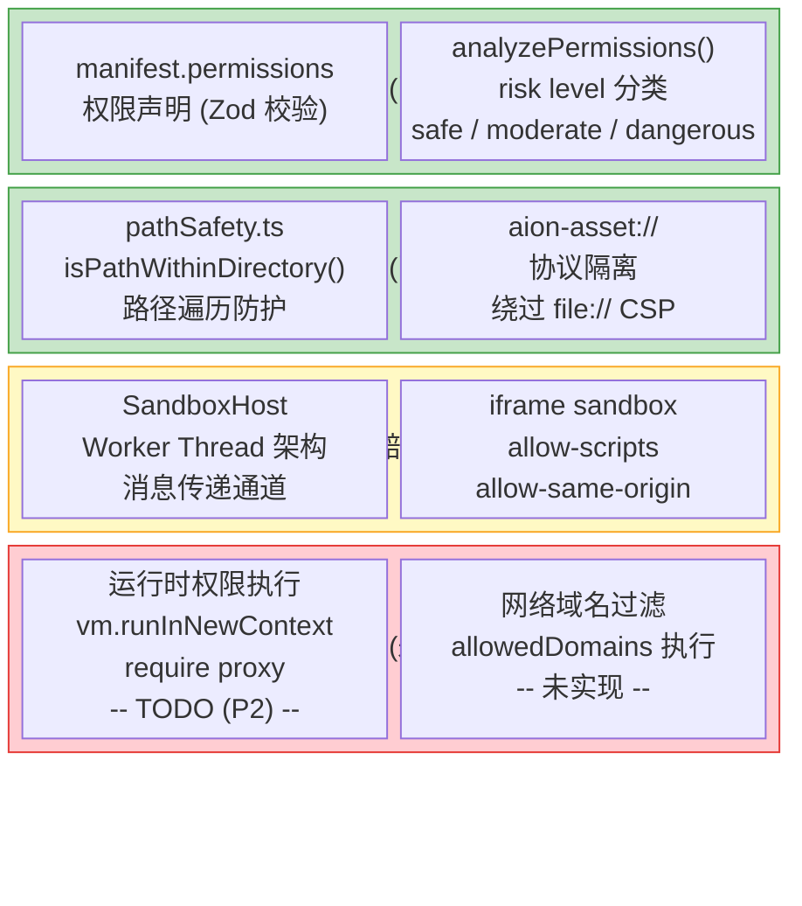
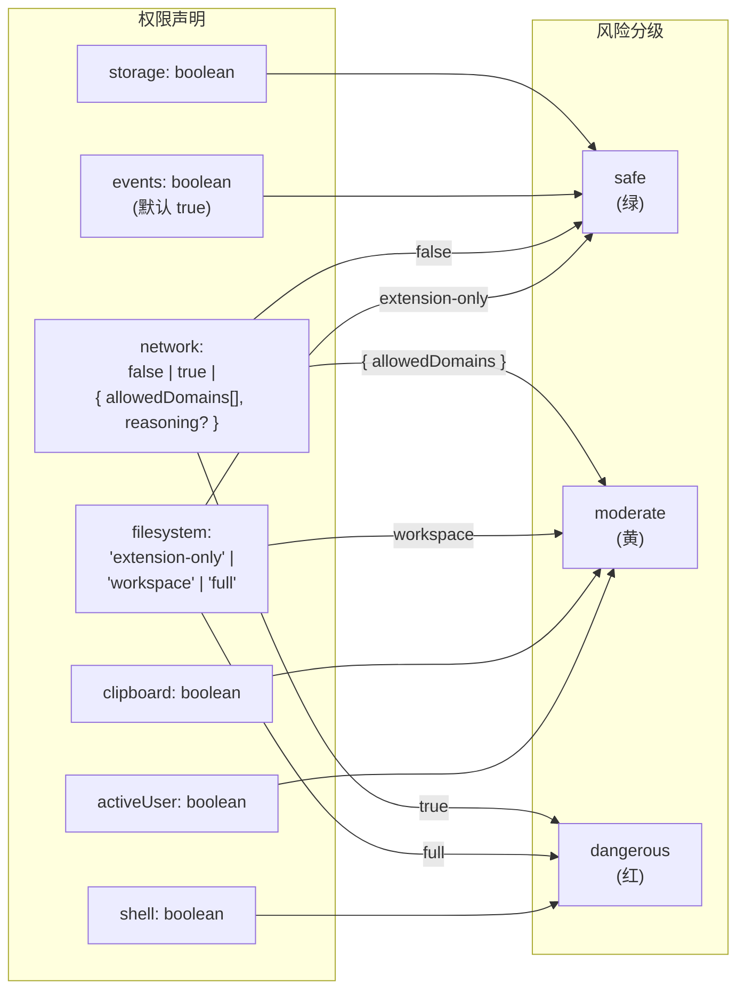
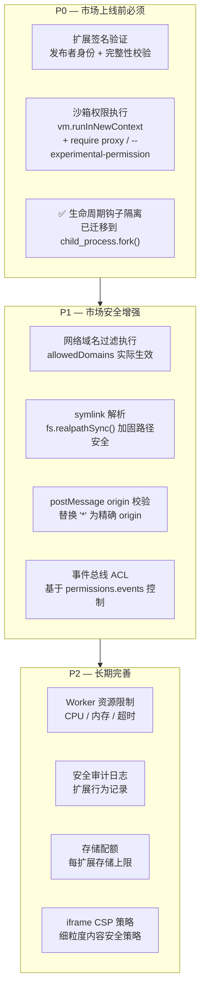

# Extension 系统 — 安全模型评估

> 日期：2026-03-30 (初版) · 2026-03-31 (更新: 沙箱 bug 修复) · 2026-09-17 (更新: 供应链信任与运行时权限执行，见第 5 节)
> 关联：[README.md](README.md) · [architecture.md](architecture.md) · [gap-analysis.md](gap-analysis.md) · [sandbox-architecture.md](sandbox-architecture.md)

## 1. 安全架构总览



## 2. 各安全层详细评估

### 2.1 路径安全 — `pathSafety.ts`

**状态: 已实现, 可靠**

**实现:** `isPathWithinDirectory(targetPath, baseDir)`

```typescript
// 核心逻辑 (pathSafety.ts:12-27)
const resolvedTarget = path.resolve(targetPath);
const resolvedBase = path.resolve(baseDir);
// 关键: 追加路径分隔符防止前缀攻击
// /home/ext 不会误匹配 /home/ext-evil/payload
const baseWithSep = resolvedBase + path.sep;
return resolvedTarget === resolvedBase || resolvedTarget.startsWith(baseWithSep);
```

**覆盖范围:** 被以下模块调用:

| 调用方                  | 检查内容                            |
| ----------------------- | ----------------------------------- |
| `lifecycle.ts`          | 生命周期钩子脚本路径                |
| `AssistantResolver`     | contextFile + avatar 路径           |
| `SkillResolver`         | skill 文件路径                      |
| `ThemeResolver`         | CSS 文件 + cover 图路径             |
| `ModelProviderResolver` | logo 路径                           |
| `SettingsTabResolver`   | entryPoint 路径                     |
| `WebuiResolver`         | API route entryPoint + 静态资产目录 |
| `ChannelPluginResolver` | entryPoint 路径                     |
| `I18nResolver`          | localesDir + 各 locale 目录         |
| `fileResolver`          | `$file:` 引用目标路径               |

**已知限制:**

- **不解析 symlink**: 扩展目录内的 symlink 可能指向外部, `isPathWithinDirectory` 只检查逻辑路径。需要 `fs.realpathSync()` 来完全防护。
- 只检查包含关系, 不检查文件存在性或权限。

---

### 2.2 权限声明系统 — `permissions.ts`

**状态: 声明层已实现, 执行层未实现**

**声明 Schema (7 个权限):**



**风险分级详表:**

| 权限         | 值                   | 风险等级  | 说明                                      |
| ------------ | -------------------- | --------- | ----------------------------------------- |
| `storage`    | `true`               | safe      | 读写 AionUI 持久化存储                    |
| `events`     | `true`               | safe      | 跨扩展事件通信                            |
| `network`    | `false`              | safe      | 无网络访问                                |
| `network`    | `{ allowedDomains }` | moderate  | 受限域名列表 (支持 `*.github.com` 通配符) |
| `network`    | `true`               | dangerous | 不受限网络访问                            |
| `filesystem` | `extension-only`     | safe      | 仅访问扩展自身目录                        |
| `filesystem` | `workspace`          | moderate  | 访问工作区目录                            |
| `filesystem` | `full`               | dangerous | 完整文件系统访问                          |
| `clipboard`  | `true`               | moderate  | 剪贴板读写                                |
| `activeUser` | `true`               | moderate  | 访问当前用户信息                          |
| `shell`      | `true`               | dangerous | 执行系统 shell 命令                       |

**关键问题:** 这些权限**仅用于 UI 展示**。`analyzePermissions()` 返回的 `PermissionSummary[]` 仅供渲染器显示权限徽章, 实际运行时扩展代码可以自由访问所有 Node.js API。

---

### 2.3 Worker Thread 沙箱

**状态: 消息通道已修复, 隔离未完成, 未接入**

> 消息路由修复详情见 [sandbox-architecture.md](sandbox-architecture.md) 和 PR [#1991](https://github.com/iOfficeAI/AionUi/pull/1991)。

```mermaid
flowchart TD
  subgraph MainThread["主进程"]
    Host["SandboxHost\n管理 Worker 生命周期\n路由消息"]
    PendingCalls["pendingCalls Map\n请求-响应追踪\n超时机制"]
    ApiHandlers["apiHandlers Map\n处理 Worker→Host RPC\n(如 storage.get/set/delete)"]
    EventBus["extensionEventBus\n转发 ext:* 事件"]
  end

  subgraph WorkerThread["Worker Thread"]
    Console["sandboxConsole\n替换 globalThis.console\n转发日志到主线程"]
    AionProxy["globalThis.aion\nextensionName\nextensionDir\npostToUI()\nemitEvent()\nstorage.get/set/delete"]
    ExtCode["扩展入口代码\n通过 eval('require') 加载"]
  end

  Host <-- "SandboxMessage\n6 种类型" --> WorkerThread

  subgraph MessageTypes["消息协议"]
    api_call["api-call: RPC 调用 (双向)"]
    api_response["api-response: RPC 响应 (双向)"]
    event["event: 事件通知 (双向)"]
    log["log: 日志转发"]
    ready["ready: Worker 就绪"]
    shutdown["shutdown: 关闭指令"]
  end

  style WorkerThread fill:#ffcdd2,stroke:#e53935
```



**超时保护:**

| 超时项              | 默认值 | 说明                                 |
| ------------------- | ------ | ------------------------------------ |
| `initTimeout`       | 10s    | Worker 启动到 `ready` 消息的最大等待 |
| `callTimeout`       | 30s    | Host→Worker 单次 RPC 调用的最大等待  |
| `CALL_MAIN_TIMEOUT` | 30s    | Worker→Host 单次 RPC 调用的最大等待  |
| 关闭超时            | 3s     | 优雅关闭等待, 超时后 force terminate |

**已修复问题 (PR #1991):**

1. ~~**`aion.storage` API 不可用**~~ — `handleMessage()` 已加 `case 'api-call'`，通过 `apiHandlers` map 路由到具体实现，回 `api-response`。无 handler 时回 error response 而不是静默丢弃。

2. ~~**`event` 回传通道未接通**~~ — `case 'event'` 已接入：`ext:*` 前缀转发到 `extensionEventBus.emitExtensionEvent()`，`ui-message` 走 `onUIMessage` 回调。

3. ~~**Worker→Host 调用无超时**~~ — `callMainThread()` 已加 30s 超时，超时后 Promise reject 并清理 pendingMainCalls。

**仍存在的问题:**

1. **Worker Thread 拥有完整 Node.js 权限** — `sandboxWorker.ts` 中明确标注:

   > _"Extension code runs with full Worker Thread privileges (Node.js built-ins accessible).
   > Declared permissions in the manifest are NOT enforced at runtime."_ (lines 17-22)

2. **Console 替换可绕过** — 扩展可通过 `process.stdout.write` 或 `require('console')` 绕过日志拦截。

3. **无 require 拦截** — 扩展可 `require('fs')`, `require('child_process')` 等任意内置模块。

4. **`createSandbox()` 未被调用** — ChannelPlugin 仍在主进程通过 `eval('require')` 裸跑，未迁移到 Sandbox。Lifecycle hooks 已迁移到 `child_process.fork()` 独立子进程（不经过 Sandbox，见 2.5 节）。

---

### 2.4 iframe 隔离

**状态: 已实现, 有改进空间**

**渲染策略:**

| 类型                      | 隔离方式                                             | 安全属性            |
| ------------------------- | ---------------------------------------------------- | ------------------- |
| 本地 HTML (aion-asset://) | `<iframe sandbox='allow-scripts allow-same-origin'>` | 脚本执行 + 同源访问 |
| 外部 URL (https://)       | `<webview>` + 独立 partition                         | 独立进程 + 缓存隔离 |

**已知问题:**

- `postMessage` 使用 `origin='*'`, 无来源验证
- 无消息体校验/Schema 验证
- 无消息大小限制

---

### 2.5 生命周期钩子安全

**状态: 已迁移到子进程 (child_process.fork)**

> 详见 [design-fix-sandbox.md](../design-fix-sandbox.md) 问题 4 和 PR #2004。

生命周期钩子 (`onInstall`/`onActivate`/`onDeactivate`/`onUninstall`) 已从主进程 `eval('require')` 迁移到 `child_process.fork()` 独立子进程执行：

- **进程级隔离**：钩子崩溃、`process.exit()`、native crash 不影响主进程
- **不阻塞主线程**：重操作（如 `bun add -g`）不卡 UI
- **超时保护**：按钩子类型差异化默认超时（onInstall 120s, onActivate 30s 等），开发者可在 manifest 中覆盖
- **非致命失败**：钩子失败不阻止扩展激活

**仍存在的限制**：

- 钩子代码在子进程中仍有完整 Node.js 权限（`fs`、`child_process`、`net` 等）
- 路径检查仅限脚本路径本身（`isPathWithinDirectory()`），脚本执行后无约束
- 不经过 Worker Thread Sandbox，无 `aion` API 可用

---

### 2.6 事件总线安全

**状态: 约定级, 无 ACL**

| 机制          | 现状                                         |
| ------------- | -------------------------------------------- |
| 命名空间      | `{extensionName}:{eventName}` 约定, 但不强制 |
| 监听权限      | 任何扩展可监听任何命名空间                   |
| 发送权限      | 任何扩展可向任何命名空间发送事件             |
| Listener 上限 | 200 (EventEmitter maxListeners)              |
| 速率限制      | 无                                           |

---

## 3. 安全改进路线图 (面向市场化)



## 4. 安全评估总表

| 层级         | 机制                                | 实现状态               | 市场化影响                       |
| ------------ | ----------------------------------- | ---------------------- | -------------------------------- |
| 路径安全     | `isPathWithinDirectory()`           | 已实现                 | 可靠, 需补 symlink               |
| 权限声明     | manifest `permissions` + Zod        | 已实现                 | UI 展示可用                      |
| 权限分析     | `analyzePermissions()` + risk level | 已实现                 | 市场上架/安装提示可用            |
| **权限执行** | vm / require proxy                  | **未实现 (TODO)**      | **市场化 blocker**               |
| Worker 沙箱  | Worker Thread + 消息传递            | 消息通道已修复, 未接入 | 需迁移 ChannelPlugin             |
| iframe 沙箱  | sandbox attribute                   | 已实现                 | 需加 origin 校验                 |
| 生命周期隔离 | child_process.fork()                | 已迁移到子进程         | 进程级隔离, 超时保护, 非致命失败 |
| 事件总线 ACL | —                                   | 无                     | 需按 permissions 控制            |
| 签名验证     | —                                   | 无                     | 市场信任链的基础                 |
| 网络过滤     | `allowedDomains`                    | 仅声明                 | 需执行层配合                     |

---

## 5. 2026-09-17 更新 — 供应链信任与运行时权限执行

> 本节描述截至 2026-09-17 **实际落地**的强制措施，以及**仍未覆盖**的部分。
> 请勿把本节当作路线图：写下来的都是代码里已经生效的行为。

### 5.1 安装时完整性校验 (`HubInstaller.ts`)

`install()` 在解压之前、对**下载到的原始 zip 字节**做 SRI 校验（`enforceIntegrity()` → `verifyIntegrity()`）。

- 支持 `sha512-<base64>` 与 `sha256-<base64>`，用 node `crypto` 流式计算，比较用 `timingSafeEqual`。
- 之前"各平台校验有差异"的顾虑不成立：校验对象是 hub 索引里那一个 zip 的字节，不是本地重新打包的产物，因此各平台结果一致。
- 策略：
  | `dist.integrity` | `bundled` | 结果 |
  | ---------------- | --------- | ----------------------------------------------------------- |
  | 有，且匹配 | 任意 | 安装继续，记录 `verified: 'integrity'` |
  | 有，但不匹配 | 任意 | 安装失败；cache/temp 里的 zip 被删除（Resources 内的不动） |
  | 无 | false | **拒绝安装**（远程包无法验证来源） |
  | 无 | true | 允许安装，记录 `verified: 'bundled'` |
- 算法不受支持或 SRI 串格式非法 → 抛错，**不再**像旧实现那样打个 warning 就跳过。

### 5.2 安装记录与更新检测 (`HubStateManager.ts`)

安装成功后写入 `hub-install-records.json`（`getDataPath()` 下）：
`{ name, version, integrity, verified, directoryDigest, installedAt }`。

- `AIONUI_HUB_INSTALL_RECORDS_FILE` 覆盖**只在测试进程内生效**（`NODE_ENV === 'test'` 或 `VITEST`）。
  发行版里忽略该变量：否则任何能设置环境变量的东西都能自带一份"已验证"的安装记录。
- `directoryDigest` 是安装目录的内容指纹（见 5.6），在 lifecycle 跑完之后、写记录之前计算，
  因此它描述的就是以后每次加载会看到的字节。
- 写入使用进程唯一的临时文件名 `${file}.${pid}.${Date.now()}.tmp`（原先固定的 `${file}.tmp`
  在并发写入时会互相把半成品 rename 到位）；记录名为 `__proto__` / `constructor` / `prototype` 时直接抛错拒绝。

`deriveStatus()` 第 3 步用该记录判断 `update_available`：索引条目的 `dist.integrity` 与记录不同即为有更新；
索引或记录缺少 integrity 时回退比较 `version`。两者都无法比较时不报更新。

> 注：该记录独立于 `extension-states.json`（`statePersistence.ts`），因为它描述的是"安装来源是否可信"，而不是扩展的启用状态。

### 5.3 Worker 沙箱运行时权限执行 (`requireGuard.ts` + `sandboxWorker.ts`)

Worker 线程在加载扩展入口**之前**安装钩子，按 manifest 声明放行内置模块
（`node:` 前缀会被剥离，`x/promises` 归入 `x` 家族）：

| 模块                                                             | 条件                                                    |
| ---------------------------------------------------------------- | ------------------------------------------------------- |
| `worker_threads` `cluster` `vm` `inspector` `v8` `repl` `module` | **始终拒绝**                                            |
| `child_process`                                                  | 需要 `shell === true`                                   |
| `fs` / `fs/promises`                                             | `filesystem !== 'none'`                                 |
| `net` `http` `https` `http2` `dns` `tls` `dgram`                 | 需要 `network` 为真值（`true` 或 `{ allowedDomains }`） |
| 其它内置模块（`path` `os` `crypto` …）                           | 放行                                                    |

拦截点有两个：`Module.prototype.require` **和** `Module._load`。只打前者时
`module.constructor._load('child_process')` 能直接拿到原始 loader；现在两条路都过同一个 guard。
`module` 本身也进了始终拒绝名单。

此外，在加载入口之前把 `process.binding`、`process._linkedBinding`、`process.dlopen`
替换成抛 `PermissionDenied` 的桩函数——它们绕开整个模块系统，直接拿内部 binding 或加载原生插件。

`new Worker(...)` 带上 `resourceLimits: { maxOldGenerationSizeMb: 512, maxYoungGenerationSizeMb: 64 }`
（`SANDBOX_RESOURCE_LIMITS`），失控的扩展被 V8 杀掉线程，而不是拖垮整机内存。

`filesystem === 'extension-only'`（也是 manifest 默认值）时，返回的 `fs` 是一个包装视图（原模块不被改写），
并且是**默认拒绝**的：

- **路径函数**：`FS_PATH_ARGUMENT_INDICES` 里列出的每一个 path 形参都必须落在扩展目录内，否则同步抛
  `PermissionDenied`。覆盖 `access` `appendFile` `chmod` `chown` `copyFile` `cp` `createReadStream`
  `createWriteStream` `exists` `glob` `lchmod` `lchown` `link` `lstat` `lutimes` `mkdir` `mkdtemp`
  `open` `openAsBlob` `opendir` `readFile` `readdir` `readlink` `realpath` `rename` `rm` `rmdir`
  `stat` `statfs` `symlink` `truncate` `unlink` `unwatchFile` `utimes` `watch` `watchFile` `writeFile`
  及其 `Sync` 变体，`fs.promises` 上的同名函数同样包装。
- **双路径函数**（`copyFile` `cp` `rename` `link` `symlink`）**两端都查**：把 `/etc/passwd` 拷进扩展目录
  和把文件写出去一样是逃逸。`realpath(.native)` / `realpathSync.native` 也各自包装。
- **显式放行**：基于文件描述符的 API（`read` `write` `close` `fstat` `ftruncate` `fsync` `futimes` …，
  描述符只能经被包装的 `open`/`opendir` 取得）和值类型（`Stats` `Dirent` `Dir` `ReadStream` `WriteStream` …）。
- **其余任何函数导出一律拒绝**。旧实现用 `Object.create(source)` 做包装，凡是没手工列进去的导出（当时是
  `copyFileSync` `appendFileSync` `renameSync` `symlinkSync` `unlinkSync` `chmodSync` `watch` …）
  都顺着原型链解析到未包装的原函数，`fs.copyFileSync('/etc/passwd','./x')` 可以直接逃出 `extension-only`。
  现在新增或平台特有的导出必须被显式归类，不会被默认继承。

路径判定复用 `isPathWithinDirectory()`（含 realpath 解析），支持 string / Buffer / `file://` URL。

未声明 `network` 时，`globalThis.fetch`（以及存在时的 `WebSocket`）被替换为抛 `PermissionDenied` 的桩函数。

所有拒绝都会向宿主 post 一条 `{ type: 'log', level: 'error', … }`，因此在主进程日志里以 `[Sandbox:<ext>]` 前缀可见。

### 5.4 ChannelPlugin 主进程加载信任门 (`ChannelPluginResolver.ts`)

**迁移到 SandboxHost 的评估结论：当前不可行，已在代码注释中说明原因。**
`BasePlugin` 契约里 `getActiveUserCount(): number` 和 `getBotInfo(): {...} | null` 是同步方法且有同步调用方，
而 SandboxHost 的消息通道是异步的；`onMessage()` / `onConfirm()` 传入的是函数回调，`onInitialize()` 传入
`IChannelPluginConfig`，都无法通过结构化克隆跨线程传递。代理这些成员需要把 channel gateway 改成全异步，属于更大范围的改动。

因此改为在 `require()` 之前加信任门（`evaluateChannelPluginTrust()`，依赖全部可注入，便于测试）。
**信任绑定的是 `ext.directory` 的内容，不是 `manifest.name`**：

1. 该扩展有 `verified: 'integrity' | 'bundled'` 的安装记录，**且**记录里的 `directoryDigest`
   与当前目录重算出来的指纹一致 → 放行；
2. 记录存在但指纹不符（或记录是没有 `directoryDigest` 的旧记录）→ **不放行**，落到第 3 步，
   并在弹窗里附一句"该扩展的文件与安装时不一致"，同时打一条 `[Extension Security] … no longer matches the recorded digest` 日志；
3. 用户此前对**这一份完全相同的文件**同意过（consent 记录是 `{ name, directoryDigest }`）→ 放行；
4. 否则弹 Electron `dialog.showMessageBoxSync` 询问一次；同意则记录 `{ name, directoryDigest }`，
   拒绝则**不加载**该扩展的所有 channel plugin，并写一条
   `[Extension Security] Blocked channel plugins from "<name>": <reason>` 日志。

修掉的问题：信任门此前只按 `manifest.name` 查安装记录，于是一个 `manifest.name` 与已安装 hub 扩展重名的
sideload 目录可以直接继承 `verified: 'integrity'`，无弹窗加载进主进程。

同意结果存在配置项 `extensions.trustedChannelPluginEntries`（`IConfigStorageRefer`）。由于 `resolveChannelPlugins()`
是同步函数而 `ConfigStorage` 只有异步 API，同意列表同时缓存在 `trusted-channel-plugins.json`（同步读），
配置项的内容会在后台并入缓存，在下一次 resolve 生效。旧的 `extensions.trustedChannelPlugins`（纯名字列表）
已废弃：纯名字的条目没法绑定目录，一律丢弃并重新询问。

如果目录指纹算不出来（目录不可读），既不放行也不记录同意——只对本次加载询问一次。

### 5.5 目录内容指纹 (`hub/directoryDigest.ts`)

`computeDirectoryDigest(dir)` 是纯函数：递归收集目录下每个普通文件的**相对路径**与文件字节的 SHA-256，
按相对路径排序后拼成 `<relative path>\0<hash>\n` 再整体做一次 SHA-256，返回 `sha256-<hex>`。

- 与遍历顺序、目录本身的路径无关；
- 内容、改名、增删任一变化都会改变指纹；
- 符号链接按**链接目标字符串**记录而不是跟随，所以把文件换成指向别处的软链也会改变指纹。

`tryComputeDirectoryDigest()` 是不抛异常的版本，返回 `null`——信任路径上"算不出指纹"绝不能等价于"可信"。

### 5.6 仍未覆盖（明确不要以为已经做了）

- **动态 `import()` 拦不住**。ESM specifier 由 V8/Node 的 ESM loader 解析，不走 CJS `Module._load`，
  因此扩展里的 `await import('child_process')` **不经过** 5.3 的任何钩子（已实测：同时打上
  `Module.prototype.require` 和 `Module._load` 钩子后，动态 import 一次都没有触发它们）。
  这是已知缺口，没有关闭。
- **原生插件**：`Module._extensions['.node']` 内部就是 `process.dlopen(module, filename)`
  （`node -e "require('module')._extensions['.node'].toString()"` 可自行确认），所以 `process.dlopen` 桩
  连带把 `require('./addon.node')` 也挡住了。但这依然只是"改了一个全局属性"级别的防护，
  不要当成沙箱边界；而且它是**副作用**，不是独立设计的检查。
- **无发布者签名**。integrity 只保证"字节和索引里写的一致"，不保证索引本身可信；索引通过 HTTPS 从
  GitHub raw / jsDelivr 获取，信任根就是这两个域名 + TLS。
- **`network.allowedDomains` 仍不执行**。`network` 是布尔式开关：给了就等于全网放行，域名列表只用于 UI 展示。
- **require 钩子仍不是安全边界**。扩展代码仍以 Worker 线程权限运行：入口加载**之前**已经存在的模块缓存引用、
  `process.stdout.write`、原型链改写、`Error.prepareStackTrace` 之类的手法都还在。
  它拦的是"忘记声明权限"和随手的误用，不是决心逃逸的恶意代码。
- **`resourceLimits` 只限堆内存**。CPU 占用、文件描述符数量、磁盘写入量都没有限制。
- **ChannelPlugin 仍在主进程裸跑**。信任门只回答"要不要加载"，加载之后没有任何权限约束。
- **`trusted-channel-plugins.json` 仍是数据目录下的普通文件**。5.3 的 fs 收紧之后 `extension-only`
  的扩展已经写不到自己目录之外，且每条 consent 都绑定了目录指纹，但任何以用户身份运行的进程仍可改写它。
- **Lifecycle hooks 仍不经过 Sandbox**（见 2.5 节），走 `child_process.fork()`，require 钩子对它们无效。
- **事件总线仍无 ACL**（见 2.6 节）。
- **iframe `postMessage` origin 仍为 `'*'`**（见 2.4 节）。
